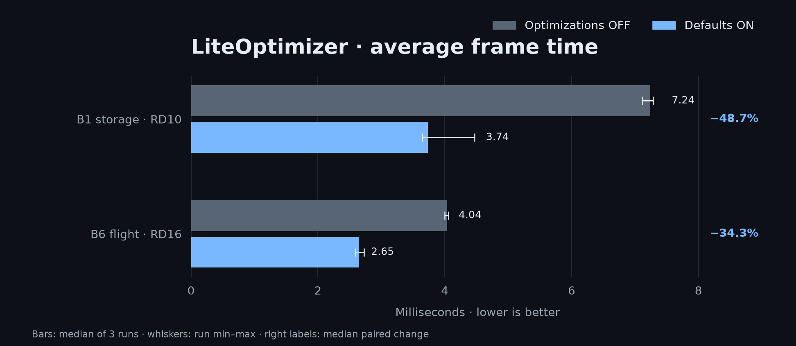
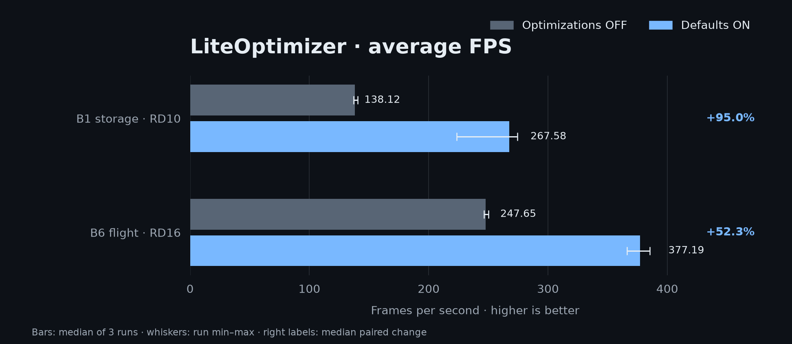
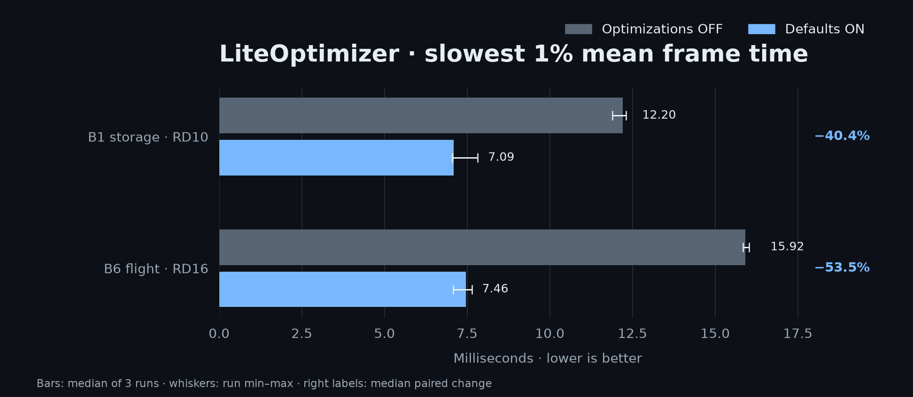
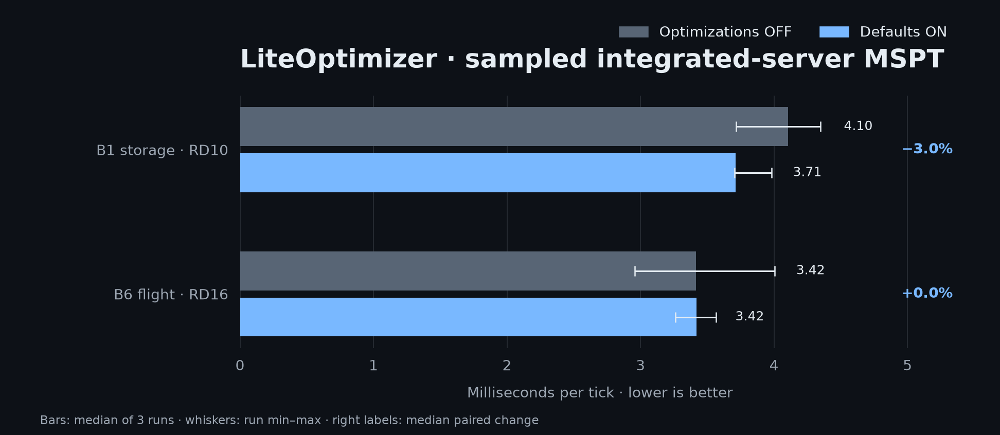

# LiteOptimizer

A client optimization mod for **Minecraft 1.12.2 + LiteLoader**. Faster terrain rendering,
less repeated work in item-frame scenes, lower model/blockstate memory use, and targeted
optimizations for singleplayer's integrated server — packaged in one `.litemod` with no
additional runtime dependencies beyond LiteLoader.

## What it optimizes

These nine optimizations are enabled by default:

| Area | Optimization | What changes |
|---|---|---|
| Terrain | `sodium` | Vintagium/Sodium-derived terrain pipeline with worker meshing, chunk visibility traversal and a fixed-function rendering backend. |
| Item frames | `model_display_lists` | Reuses compiled item/block model geometry for item-frame draws instead of tessellating the same models each frame. |
| Block-entity rendering | `tile_entity_frustum` | Skips eligible block-entity draws outside conservative camera bounds. Ticking is unaffected. |
| Camera visibility | `camera_visgraph_cache` | Reuses the camera section's visibility flood fill until the camera block or section data changes. |
| Blockstate memory | `blockstate_property_storage` | Shares an indexed state-transition table per block container instead of a Guava table per state. |
| Model memory | `baked_quad_dedup` | Shares identical baked model quads during model loading. |
| Property lookups | `property_hashcode_cache` | Caches immutable block-property hash codes used by blockstate lookups. |
| Hopper searches | `hopper_entity_lookup` | Maintains per-section inventory-entity lists to narrow hopper searches while preserving candidate order. |
| Structure queries | `structure_lookup_index` | Indexes structure bounds by chunk for spawning-related position queries. |

World logic optimizations affect the **integrated server in singleplayer**. They cannot speed up
a remote server that does not run this mod. Memory savings and rendering improvements apply to
the client. Other candidate switches exist in the source, but remain disabled and are normalized
off in saved configs until their evidence requirements are met.

## Benchmarks

Three paired runs compare all optimization switches **OFF** with the release defaults **ON**.
They use the same LiteLoader client stack in both modes; this is not a comparison with bare
Minecraft. Each run had 30 seconds of warmup and 60 seconds of recording. Percent changes below
are the median of the three paired changes; graphs show each mode's median and run range.









| Scene | Average FPS | Average frame time | Slowest 1% mean frame time | Sampled integrated-server MSPT |
|---|---:|---:|---:|---:|
| B1 storage, RD10; entities suppressed | 138.1 → 267.6 (**+95.0%**) | 7.240 → 3.737 ms (**−48.7%**) | 12.205 → 7.086 ms (**−40.4%**) | 4.105 → 3.713 ms (**−3.0%**) |
| B6 forward flight, RD16; 0.5 blocks/tick | 247.6 → 377.2 (**+52.3%**) | 4.038 → 2.651 ms (**−34.3%**) | 15.920 → 7.456 ms (**−53.5%**) | 3.417 → 3.419 ms (**+0.0%**) |

The three B1 FPS pair changes ranged from **+61.9% to +95.3%**; B6 ranged from **+48.7% to
+54.1%**. The first B1 pair was lower than the other two in ON mode, so its spread is shown
instead of treating the median as a guaranteed result. B1 and B6 are distinct scenes, not
repeats of one workload.

The integrated-server figure is sampled MSPT from the singleplayer client. It does not represent
remote server TPS; samples may miss ticks. B6 showed no consistent change across pairs. No claim
is made that a remote server runs faster.

The structure lookup feature was also isolated over three B4 pairs. Its median paired FPS change was
**−0.3%**, with pair changes from **−0.6% to +0.3%**, so this run found no measurable rendering
gain. Sampled MSPT fell by a median **15.6%** across this one workload (pair changes −16.8% to
−11.4%); treat that as fixture-specific evidence, not a general server-speed result. One-pair memory checks are preliminary: blockstate storage changed FPS by **+0.3%** and
baked-quad deduplication by **+1.0%**. A class histogram recorded **43,690 to 29,214 baked
quads** (33.1% fewer unique instances); this count does not establish a total-heap percentage.

Measurements used a Ryzen 5 2600, GTX 1660 SUPER, Java 8u504, 1920×1080, VSync off and the
technical LiteLoader stack. Minecraft's maximum 260 FPS setting (unlimited) was selected.
The workload worlds are not distributed, and results depend on scene and hardware. Raw CSVs,
effective configs, per-run summaries, hardware details and calculation notes are in the
[benchmark evidence](docs/benchmarks/README.md).

Older individual-feature results remain in that report with their original provenance and limits;
they are not combined with these measurements.

## Install

1. Install Minecraft **1.12.2** with **LiteLoader 1.12.2** and Java 8.
2. Build the mod below, or use an artifact when one is published.
3. Put `liteoptimizer-liteloader-1.12.2.litemod` in your instance's `mods/1.12.2/` folder.
4. Launch the game. No server plugin or mod is needed.

This is a LiteLoader mod, not a Forge `.jar` or Fabric mod. Do not install another Sodium/Vintagium
terrain renderer alongside it. Newlight provides lighting optimization separately; LiteOptimizer
does not replace its lighting engine.

## Configuration

The main config is `liteconfig/common/liteoptimizer.json` in the Minecraft instance. It is written
on first launch; `_help` describes each key. Pillar switches are `render`, `world`, `ai` and `memory`.
For example, this valid JSON disables only the item-frame display-list feature while leaving
missing keys at their defaults:

```json
{
  "model_display_lists": false
}
```

Restart after editing: mixins are selected at startup. Malformed config falls back to defaults.
An existing `true` for a candidate that has not cleared the evidence gate is rewritten to `false`.

Renderer settings are in `liteconfig/common/liteoptimizer-sodium.json` and the video options UI.
The production renderer fixes the backend and vertex format to the conservative fixed-function
path, disables face/fog/entity-graph culling, and keeps translucency sorting on. Legacy shader
backends and compact vertices are excluded from the production configuration.

## Build from source

Requires **JDK 8**. The Gradle 4.10.3 wrapper and ForgeGradle 2.3 do not support running this build
on a modern JDK. Set `JAVA_HOME` to your Java 8 installation:

```bash
export JAVA_HOME=/path/to/jdk8
./gradlew build
```

Output: `build/libs/liteoptimizer-liteloader-1.12.2-0.6.0-rc2.litemod`.
Once dependencies are cached, use `./gradlew build --offline`. A fresh checkout needs network
access to the legacy Forge/Sponge dependencies. Source targets Java 8, MCP `stable_39` and
LiteLoader's Mixin 0.7.5 runtime. No MixinExtras or MaLiLib dependency is required.

## Credits and license

Licensed under **LGPL-3.0-or-later**; bundled components retain their own licenses and copyright
notices. See [LICENSE](LICENSE) and [license texts](licenses/).

The terrain port derives from **Vintagium and Sodium 0.4**, originally by JellySquid/CaffeineMC
and contributors. Other code and ideas draw from **carpetmod112, FoamFix, VintageFix, Lithium,
FerriteCore, VanillaFix, ParticleCulling, Valkyrie and better-biome-blend**. Repackaged **JOML** is
MIT licensed. Upstream authorship and source headers are retained.
